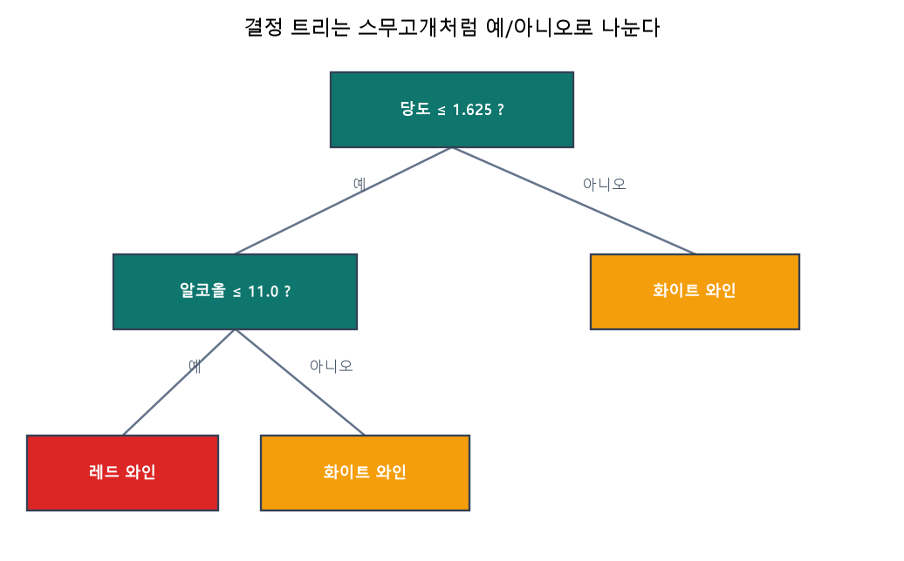
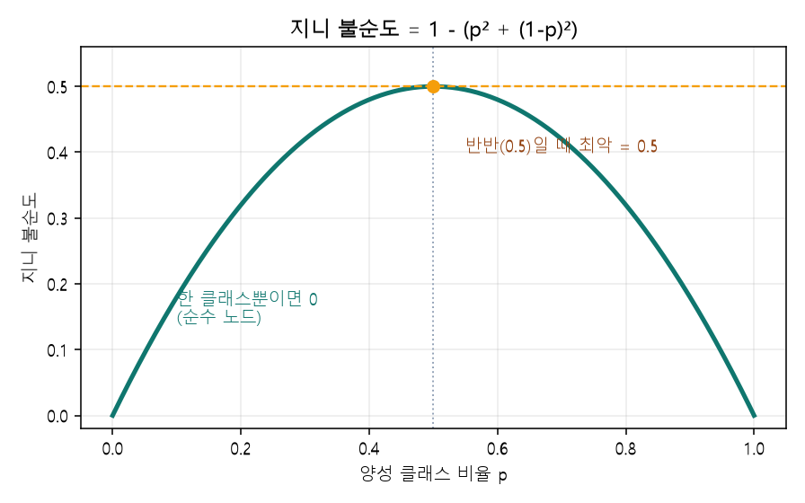
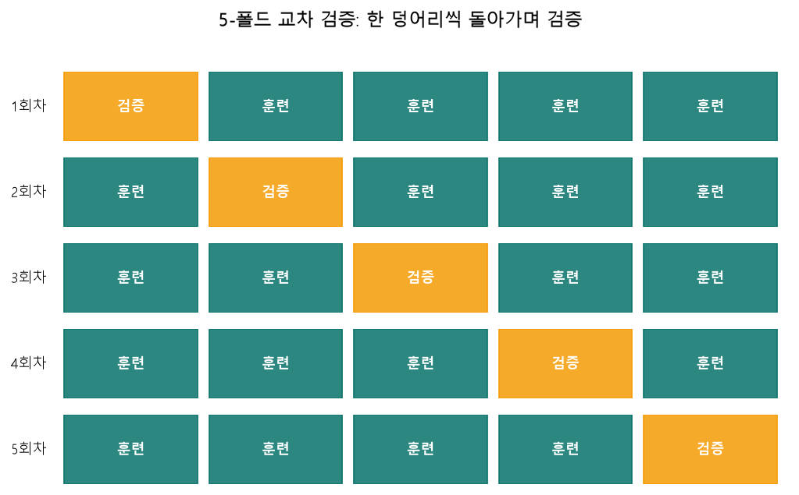
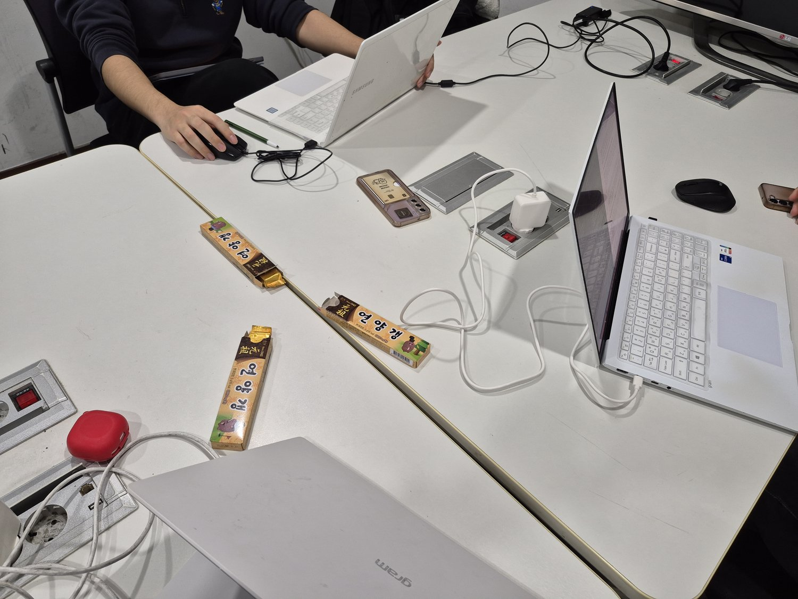

# 📘 MLB 5주차 — 결정 트리 & 교차 검증/그리드 서치

> **학습 범위**: 결정 트리(05-1) → 교차 검증과 그리드 서치(05-2)
> **실습**: 캔 와인 분류 — 알코올 도수 · 당도 · pH 로 **레드/화이트 와인** 구분 (6,497개)
> **복습**: 2주차 KNN 기초(갈라파고스 핀치) + 4주차 로지스틱 회귀 · 확률적 경사 하강법

---

## 🧭 이번 주 목표

1. 결정 트리가 **스무고개**처럼 예/아니오 질문을 이어가며 분류하는 과정을 이해한다.
2. **불순도(지니 · 엔트로피)** 와 **정보 이득**으로 노드가 나뉘는 원리를 안다.
3. **가지치기(max_depth)** 와 **특성 중요도**로 모델을 다듬고 해석한다.
4. **검증 세트 → 교차 검증 → 그리드/랜덤 서치**로 하이퍼파라미터를 찾는다.

---

## 1. 로지스틱 회귀로는 왜 부족했을까?

한빛 마켓의 캔 와인은 실수로 **레드/화이트 표시가 누락**되었습니다. 알코올 도수 · 당도 · pH 세 특성으로 와인 종류를 맞혀야 합니다. 타깃 `class`는 **0이면 레드, 1이면 화이트**(양성 클래스 = 화이트)인 이진 분류 문제입니다.

먼저 4주차에 배운 **로지스틱 회귀**를 그대로 적용해 봅니다.

```python
import pandas as pd

wine = pd.read_csv('https://bit.ly/wine_csv_data')
data = wine[['alcohol', 'sugar', 'pH']].to_numpy()
target = wine['class'].to_numpy()
```

```python
from sklearn.model_selection import train_test_split
from sklearn.preprocessing import StandardScaler
from sklearn.linear_model import LogisticRegression

train_input, test_input, train_target, test_target = train_test_split(
    data, target, test_size=0.2, random_state=42)

ss = StandardScaler()
train_scaled = ss.fit_transform(train_input)
test_scaled = ss.transform(test_input)

lr = LogisticRegression()
lr.fit(train_scaled, train_target)
print(lr.score(train_scaled, train_target))   # 0.781
print(lr.score(test_scaled, test_target))     # 0.778
print(lr.coef_, lr.intercept_)
```

```text
[[ 0.51270274  1.6733911  -0.68767781]] [1.81777902]
```

- 훈련·테스트 점수가 **둘 다 낮아** 과소적합된 모델입니다. 화이트 와인을 골라내기가 생각보다 어렵습니다.
- 더 큰 문제는 **설명**입니다. "알코올에 0.51을 곱하고, 당도에 1.67을 곱하고, pH에 −0.69를 곱해 더한 값이 0보다 크면 화이트"라고 말해도, **왜 그런 숫자가 나왔는지**는 아무도 이해하기 어렵습니다.

> **💡 이사님의 한마디**
> "보고서를 보고 이 일을 계속할지 결정할 수가 없군요. **순서도처럼 쉽게** 설명해서 다시 가져오세요."
> → 그래서 등장한 것이 **결정 트리**입니다.

---

## 2. 결정 트리 (05-1)

### 1) 스무고개와 같은 알고리즘

결정 트리는 **예/아니오 질문을 하나씩 던져 정답을 좁혀 가는** 알고리즘입니다.



> 당도가 1.625보다 큰가? → 알코올이 11.0 이하인가? → … 처럼 **질문의 순서**가 곧 모델입니다.

- 로지스틱 회귀 = **계수**로 표현 → 어렵다
- 결정 트리 = **질문(규칙)** 으로 표현 → 쉽다

```python
from sklearn.tree import DecisionTreeClassifier

dt = DecisionTreeClassifier(random_state=42)
dt.fit(train_scaled, train_target)
print(dt.score(train_scaled, train_target))   # 0.9969
print(dt.score(test_scaled, test_target))     # 0.8592
```

- 훈련 세트는 거의 **100%** 를 맞히지만 테스트는 86%로, **과대적합**된 모습입니다. (뒤에서 가지치기로 다듬습니다.)

### 2) 노드 · 루트 노드 · 리프 노드

트리는 **위에서 아래로** 자라납니다(거꾸로 된 나무).

| 용어 | 뜻 |
|---|---|
| **노드(node)** | 질문(테스트)을 담는 상자. 예: "당도 ≤ −0.239?" |
| **루트 노드(root)** | 맨 위의 시작 노드 |
| **리프 노드(leaf)** | 맨 아래 끝 노드. 여기서 예측값이 결정됨 |
| **가지(branch)** | 질문의 결과(예/아니오)를 따라가는 길 |

`plot_tree()`로 그림을 그려 확인할 수 있습니다.

```python
import matplotlib.pyplot as plt
from sklearn.tree import plot_tree

plt.figure(figsize=(10, 7))
plot_tree(dt, max_depth=1, filled=True, feature_names=['alcohol', 'sugar', 'pH'])
plt.show()
```

노드 상자에는 4가지 정보가 담깁니다.

- **테스트 조건**: `sugar <= -0.239`
- **불순도(gini)**: `gini = 0.367`
- **총 샘플 수(samples)**: `5197`
- **클래스별 샘플 수(value)**: `[레드 1258, 화이트 3939]`

### 3) 불순도 — 질문을 고르는 기준

**지니 불순도**는 노드 안이 **얼마나 뒤섞여 있는지**를 나타냅니다. 계산은 아주 간단합니다.

> **지니 불순도 = 1 − (음성 클래스 비율² + 양성 클래스 비율²)**



루트 노드(레드 1,258 / 화이트 3,939)의 지니 불순도:

```text
1 - ((1258/5197)² + (3939/5197)²) = 0.367
```

| 상황 | 지니 불순도 | 의미 |
|---|---|---|
| 반반 (50 : 50) | **0.5** | 가장 뒤섞임 = 최악 |
| 한 클래스뿐 (0 : 100) | **0** | 깨끗함 = **순수 노드** |

> **💡 쉬운 예시**
> 피자 100조각을 두 명이 딱 50 : 50으로 나누면 "누구 것인지" 헷갈립니다(= 불순도 0.5).
> 한 명이 100조각을 다 가지면 헷갈릴 게 없습니다(= 불순도 0). 결정 트리는 **덜 헷갈리는 쪽**으로 질문을 고릅니다.

### 4) 정보 이득 — 부모와 자식의 불순도 차이

부모 노드가 자식 노드로 나뉠 때 **불순도가 얼마나 줄었는지**를 **정보 이득**이라고 합니다.

> **정보 이득 = 부모 불순도 − (왼쪽 샘플비 × 왼쪽 불순도) − (오른쪽 샘플비 × 오른쪽 불순도)**

루트 노드가 왼쪽(2,922개, 0.481) / 오른쪽(2,275개, 0.069)으로 나뉜 경우:

```text
0.367 - (2922/5197)×0.481 - (2275/5197)×0.069 = 0.066
```

- 결정 트리는 **정보 이득이 최대가 되는** 특성과 기준값을 찾아 데이터를 나눕니다.
- 즉, "가장 많이 뒤섞임을 줄여 주는 질문"을 고르는 셈입니다.

### 5) 엔트로피 불순도

`criterion='entropy'`로 지정하면 지니 대신 **엔트로피**를 씁니다. 로그를 사용합니다.

> **엔트로피 = −Σ (클래스 비율 × log₂(클래스 비율))**

루트 노드의 엔트로피:

```text
-(1258/5197)×log₂(1258/5197) - (3939/5197)×log₂(3939/5197) = 0.798
```

보통 기본값인 **지니**와 엔트로피의 결과 차이는 크지 않습니다. 여기서는 지니를 사용합니다.

### 6) 가지치기 — 트리가 무한정 자라지 않게

과수원에서 가지를 치듯, 트리도 **성장을 제한**해야 일반화가 잘 됩니다. 가장 간단한 방법은 **최대 깊이**를 지정하는 것입니다.

```python
dt = DecisionTreeClassifier(max_depth=3, random_state=42)
dt.fit(train_scaled, train_target)
print(dt.score(train_scaled, train_target))   # 0.8455
print(dt.score(test_scaled, test_target))     # 0.8415
```

- 훈련 점수는 낮아졌지만 **테스트 점수는 거의 그대로**입니다.
- 트리가 훨씬 단순해져 **해석이 쉬워집니다**.

### 7) 특성 중요도 — 어떤 특성이 중요한가?

`feature_importances_`에 **각 특성이 불순도를 줄이는 데 기여한 정도**가 저장됩니다.

```python
print(dt.feature_importances_)
```

```text
[0.12345626 0.86862934 0.0079144 ]   # alcohol, sugar, pH
```

- **당도(sugar) 0.87** 로 압도적입니다. 그다음 알코올, pH 순입니다.
- 값은 모두 더하면 **1**이 됩니다. 이 값으로 **특성 선택**에 활용할 수 있습니다.

### 8) 결정 트리는 표준화가 필요 없다

불순도는 **클래스 비율**로만 계산하므로, 특성값의 **스케일이 결과에 영향을 주지 않습니다**.

```python
dt = DecisionTreeClassifier(max_depth=3, random_state=42)
dt.fit(train_input, train_target)   # 표준화 안 한 원본 데이터
print(dt.score(train_input, train_target))   # 0.8455
print(dt.score(test_input, test_target))     # 0.8415  ← 표준화와 동일
```

게다가 원본 스케일로 그리면 훨씬 읽기 쉽습니다.

> "당도가 **1.625보다 크고 4.325보다 작은** 와인 중 알코올 도수가 **11.025 이하**인 것이 레드 와인"

> **💡 한 줄 정리**
> 결정 트리는 **스케일 무관 · 해석 용이 · 특성 중요도 제공**이라는 강력한 장점을 가집니다.

---

## 3. 교차 검증과 그리드 서치 (05-2)

### 1) 검증 세트가 필요한 이유

`max_depth`를 3 말고 다른 값으로 바꾸면 성능이 달라질 수 있습니다. 그런데 **테스트 세트로 여러 값을 평가**하면, 결국 **테스트 세트에 맞는 모델**을 고르게 됩니다.

> 테스트 세트는 **마지막에 딱 한 번**만 써야 합니다.

그래서 **훈련 세트를 다시 쪼개** 검증용 데이터를 만듭니다. 이것이 **검증 세트(validation set)** 입니다.

```text
전체 ─┬─ 훈련 세트 ─┬─ 훈련(sub)  약 60%
      │            └─ 검증(val)   약 20%
      └─ 테스트 세트              약 20%
```

```python
sub_input, val_input, sub_target, val_target = train_test_split(
    train_input, train_target, test_size=0.2, random_state=42)
print(sub_input.shape, val_input.shape)   # (4157, 3) (1040, 3)
```

### 2) 교차 검증 — 여러 번 나눠서 안정적으로

검증 세트를 떼면 훈련 데이터가 줄어듭니다. **교차 검증**은 훈련 세트를 **k개 폴드**로 나눠, 한 폴드씩 돌아가며 검증하는 방법입니다.



```python
from sklearn.model_selection import cross_validate
import numpy as np

scores = cross_validate(dt, train_input, train_target)   # 기본 5-폴드
print(np.mean(scores['test_score']))                     # 0.8553
```

- `test_score`는 **검증 폴드**의 점수입니다. (이름에 속지 마세요!)
- 분류 모델은 클래스 비율을 유지하는 **StratifiedKFold**를 기본으로 씁니다.

```python
from sklearn.model_selection import StratifiedKFold

splitter = StratifiedKFold(n_splits=10, shuffle=True, random_state=42)
scores = cross_validate(dt, train_input, train_target, cv=splitter)
print(np.mean(scores['test_score']))   # 0.8574
```

> **💡 쉬운 예시**
> 모의고사를 **딱 한 번** 보면 그날 컨디션에 점수가 흔들립니다.
> **5번** 보면 실력이 더 안정적으로 보이죠. 교차 검증은 "여러 번 나눠 본 모의고사"입니다.

### 3) 하이퍼파라미터 튜닝

| 구분 | 설명 |
|---|---|
| **모델 파라미터** | 모델이 **스스로 학습**하는 값 (예: 계수, 트리의 분할 기준) |
| **하이퍼파라미터** | **사용자가 지정**하는 값 (예: `max_depth`, `min_samples_split`) |

- ⚠️ 매개변수는 **서로 영향을 줍니다.** `max_depth` 최적값은 `min_samples_split`이 바뀌면 함께 달라집니다.
- 따라서 **여러 매개변수를 동시에** 바꿔 가며 찾아야 합니다.

### 4) 그리드 서치 (GridSearchCV)

탐색할 값을 **미리 나열**하면, 교차 검증까지 자동으로 돌려 최적 조합을 찾아 줍니다.

```python
from sklearn.model_selection import GridSearchCV

params = {'min_impurity_decrease': np.arange(0.0001, 0.001, 0.0001),
          'max_depth': range(5, 20, 1),
          'min_samples_split': range(2, 100, 10)}

gs = GridSearchCV(DecisionTreeClassifier(random_state=42), params, n_jobs=-1)
gs.fit(train_input, train_target)

print(gs.best_params_)
print(np.max(gs.cv_results_['mean_test_score']))
```

- 조합 수: **9 × 15 × 10 = 1,350**, 5-폴드이므로 **6,750개 모델**을 훈련합니다.
- `n_jobs=-1`로 **모든 CPU 코어**를 사용해 병렬 처리합니다.

| 속성 | 의미 |
|---|---|
| `best_params_` | 최상의 매개변수 조합 |
| `best_estimator_` | 최상 조합으로 **전체 훈련 세트**에서 다시 훈련한 모델 |
| `cv_results_['mean_test_score']` | 각 조합의 평균 검증 점수 |

### 5) 랜덤 서치 (RandomizedSearchCV)

값의 범위가 넓거나 연속적이면, 목록 대신 **확률 분포**에서 샘플링합니다.

```python
from scipy.stats import uniform, randint
from sklearn.model_selection import RandomizedSearchCV

params = {'min_impurity_decrease': uniform(0.0001, 0.001),
          'max_depth': randint(20, 50),
          'min_samples_split': randint(2, 25),
          'min_samples_leaf': randint(1, 25)}

gs = RandomizedSearchCV(DecisionTreeClassifier(random_state=42), params,
                        n_iter=100, n_jobs=-1, random_state=42)
gs.fit(train_input, train_target)
print(gs.best_params_)
```

- `randint`는 **정수**, `uniform`은 **실수**를 범위 안에서 고르게 뽑습니다.
- `n_iter`로 **샘플링 횟수**를 정합니다. 그리드 서치보다 넓은 공간을 효율적으로 탐색합니다.

```text
best_params_ → {'max_depth': 39, 'min_impurity_decrease': 0.0003410...,
                'min_samples_leaf': 7, 'min_samples_split': 13}
최고 검증 점수 → 0.8695
최종 테스트 점수 → 0.86
```

> **💡 한 줄 정리**
> 검증 세트는 **테스트 세트를 아끼기 위한** 장치, 교차 검증은 **안정적인 평가**, 그리드/랜덤 서치는 **자동 튜닝**입니다.

---

## 4. 🔬 실습: 캔 와인 분류 (손코딩 요약)

```python
import pandas as pd
import numpy as np
from sklearn.model_selection import train_test_split
from sklearn.tree import DecisionTreeClassifier

wine = pd.read_csv('https://bit.ly/wine_csv_data')
data = wine[['alcohol', 'sugar', 'pH']].to_numpy()
target = wine['class'].to_numpy()

train_input, test_input, train_target, test_target = train_test_split(
    data, target, test_size=0.2, random_state=42)

# 표준화가 필요 없어서 원본 데이터를 그대로 사용
dt = DecisionTreeClassifier(max_depth=3, random_state=42)
dt.fit(train_input, train_target)

print(dt.score(train_input, train_target))   # 0.8455
print(dt.score(test_input, test_target))     # 0.8415
print(dt.feature_importances_)               # [0.123 0.869 0.008]
```

### 결과 정리

| 모델 | 설정 | 훈련 정확도 | 테스트 정확도 |
|---|---|---|---|
| 로지스틱 회귀 | 표준화 + 기본 | 0.781 | 0.778 |
| 결정 트리 | 제한 없음 | 0.9969 | 0.8592 |
| 결정 트리 | `max_depth=3` | 0.8455 | 0.8415 |
| 랜덤 서치 최적 | `n_iter=100` | — | **0.8600** |

- 결정 트리는 **특성을 추가하지 않고도** 로지스틱 회귀보다 좋은 성능을 냈습니다.
- 테스트 점수는 검증 점수보다 **조금 낮게** 나오는 것이 일반적입니다.

---

## 5. 📚 복습 — 지난 주까지 배운 것

### 2주차: 갈라파고스 핀치로 배운 ML 기초

| 개념 | 핵심 한 줄 |
|---|---|
| **특성 / 학습 / 모델** | 데이터를 표현하는 성질 / `fit()`으로 규칙을 찾음 / 알고리즘이 구현된 객체 |
| **지도 vs 비지도** | 정답을 주고 배움 vs 정답 없이 패턴을 찾음 |
| **훈련 / 테스트 세트** | 배우는 데이터 / **한 번도 안 본** 데이터 (보통 20~50%) |
| **KNN** | 규칙을 만들지 않고 데이터를 **저장**만 함. 가장 가까운 **k개 다수결** (게으른 학습) |
| **정확도** | 맞힌 개수 ÷ 전체 개수 |
| **데이터 전처리** | 스케일을 맞춤. **표준점수** = (값 − 평균) ÷ 표준편차 |

- **표준화는 반드시 훈련 세트의 평균·표준편차**로! 테스트 세트로 다시 `fit`하면 **데이터 누수**가 생깁니다.
- **브로드캐스팅**: 크기가 다른 numpy 배열끼리 자동으로 확장해 연산합니다.
- 핀치 실습(49마리, `[:35]` / `[35:]`)에서 **변수 오타(`trian_input`)로 그래프가 통째로 바뀐 사건**과 **점이 겹쳐 보인 이유**, **노트북의 메모리 잔상**을 정리했습니다.

> **💡 2주차의 교훈**
> 변수는 "데이터를 담는 상자"가 아니라 **메모리 객체를 가리키는 이름표**입니다. 노트북은 마지막 셀까지 변수가 살아 있으니, **모두 실행**으로 순서를 맞추는 습관이 중요합니다.

### 4주차: 로지스틱 회귀 & 확률적 경사 하강법

| 개념 | 핵심 한 줄 |
|---|---|
| **로지스틱 회귀** | 선형 방정식을 **시그모이드/소프트맥스**로 통과시켜 확률로 분류 |
| **시그모이드** | 임의의 값을 **0~1**로 압축. **이진 분류** |
| **소프트맥스** | 여러 점수를 **합이 1인 확률**로 정규화. **다중 분류** |
| **손실 함수** | 이진 → 이진 크로스엔트로피, 다중 → 크로스엔트로피, 회귀 → MSE |
| **확률적 경사 하강법** | 샘플 **하나씩** 꺼내 손실의 경사를 따라 최적화 (미니배치/배치) |
| **에포크** | 전체 샘플을 **한 번** 다 쓰는 반복 |

> **💡 4주차 → 5주차 연결**
> 로지스틱 회귀는 **계수**로 답하지만 설명이 어렵습니다. 그래서 5주차에서는 **질문(규칙)** 으로 답하는 **결정 트리**를 배웠습니다.

---

## 6. 📸 스터디 현장

이번 주는 **팀 챌린지**로 스터디를 진행했습니다. 중간중간 **양갱으로 에너지를 충전**하면서 끝까지 집중했어요. 🍡



---

## 7. 📝 스터디 한 줄 회고

> 이번 주는 **"설명할 수 있는 모델"** 의 가치를 배웠습니다.
> 로지스틱 회귀의 계수는 정확해도 **왜 그런지** 말하기 어려웠는데, 결정 트리는 **질문의 흐름**으로 답을 보여 줍니다.
> **불순도 → 정보 이득 → 가지치기 → 특성 중요도**로 이어지는 흐름을 따라가니 트리가 자라는 원리가 손에 잡혔습니다.
> 그리고 `max_depth` 하나를 고르는 일조차 **검증 세트 · 교차 검증 · 그리드/랜덤 서치**로 자동화할 수 있다는 점이 인상 깊었습니다.
> 다음에는 결정 트리를 확장한 **앙상블(랜덤 포레스트·부스팅)** 을 정리해 보고 싶습니다.

---

*이 노트는 GitHub Pages로 공유한 스터디 기록입니다.*
